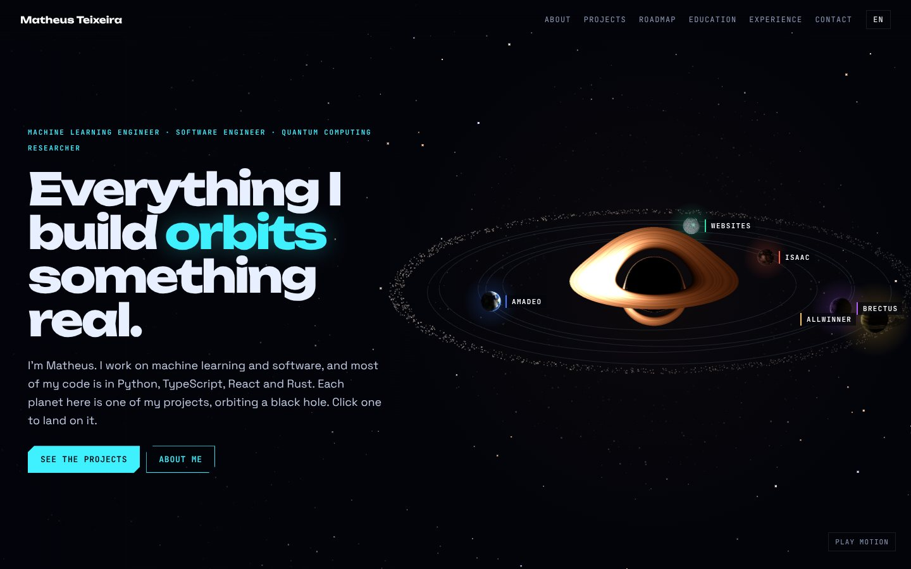
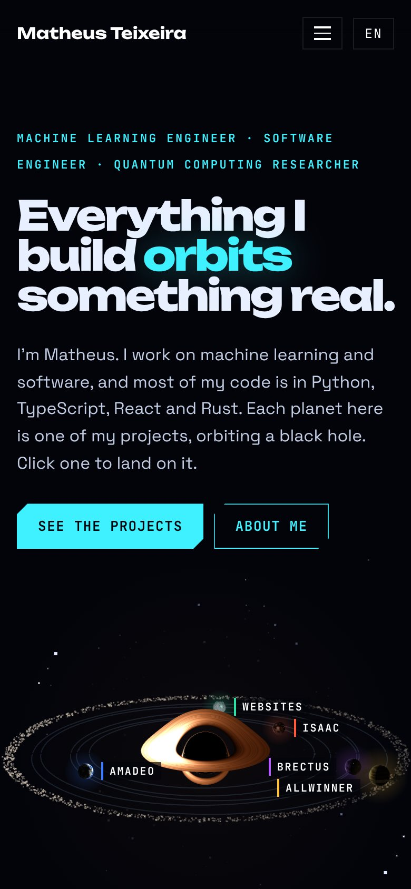
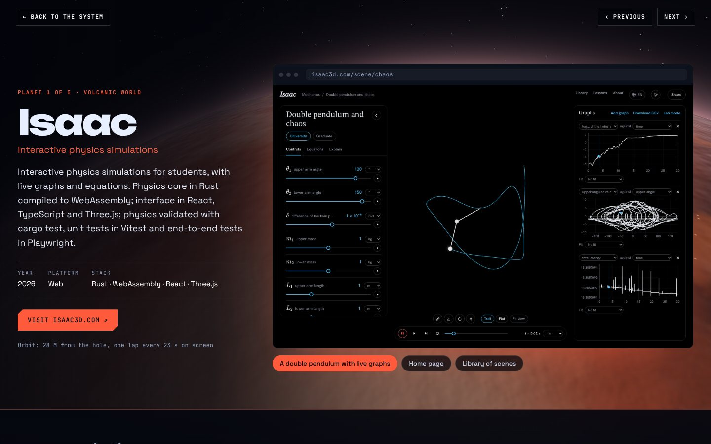
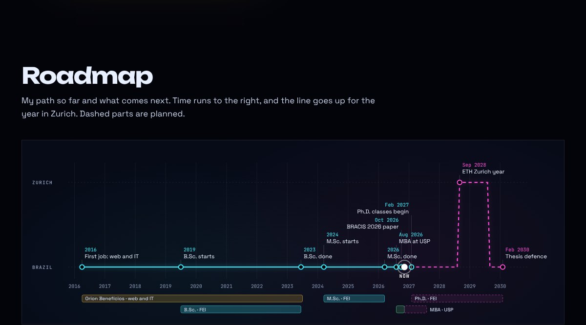

<p align="center">
  <a href="https://sectus.dev"></a>
</p>

<p align="center">
  <a href="https://sectus.dev"></a>
  
  
  
  <a href="https://github.com/matheusrteixeira-dev/orbits/actions/workflows/deploy.yml"></a>
</p>

This is my personal website. Each planet holds one of my projects, and they all orbit a black hole
that is traced on the graphics card with the same code as [Isaac](https://isaac3d.com). Click a planet
and the camera lands on it, and the project opens there. It is static HTML, CSS and JavaScript in eight
languages, with no framework, and the build needs only Python 3.

<table>
  <tr>
    <td width="68%" valign="top"><a href="https://sectus.dev"></a></td>
    <td width="32%" valign="top"><a href="https://sectus.dev"></a></td>
  </tr>
  <tr>
    <td colspan="2"><a href="https://sectus.dev/#isaac"></a></td>
  </tr>
</table>

## The black hole

<p align="center"></p>

`src/assets/js/sky.js` traces the hole in a WebGL 2 fragment shader. Every pixel follows its light ray
backwards from the camera (600 M away, 18° above the disc) through the Schwarzschild metric. The ray
stays in the plane through the hole that holds the camera and the ray, where the null geodesic obeys
d²u/dφ² = 3u² − u (u = 1/r). It is integrated with RK4 until it falls through the horizon, crosses the
disc or escapes. The disc runs from the ISCO (6 M) to 15 M with the thin-disc flux F, seen as g⁴F with a
black-body colour shifted by g (gravitational redshift, time dilation and Doppler shift). Rays that
circle the hole before reaching the disc draw the thin ring round the shadow. The disc is symmetric
about its axis, so the image is traced once, a band of rows per frame, and kept; four samples per pixel
smooth its edges. `src/assets/bh/bh-still.webp` is shown where WebGL 2 is not available.

The planets and the belt orbit in the plane of the disc on one clock (40 M of time per second) and one
distance scale. Planet orbits precess at Ω − κ, with Ω = r^−1.5 and κ = Ω √(1 − 6/r) the radial
epicyclic frequency, and planets and belt are brightened or dimmed by g⁴ like the disc. The hole is
taken as 10⁸ solar masses, so every planet orbits outside its Roche limit. The camera circles the hole
once every three hours of screen time; the distant stars sweep past at the matching rate and are lensed
with the point-mass lens.

Two display choices are not physical: the orbits, belt and planets are drawn without the bending of
their light (which would lift the far side of every orbit over the hole), and the planets are drawn
thousands of times larger than they would be.

## What is on the site

| | |
|---|---|
| **About** | a short introduction and a terminal with what I am doing now |
| **Projects** | Isaac, Amadeo, Brectus, the company websites and Allwinner, each as a case study on its planet: the product, how its parts fit together, what is tested, engineering notes, screenshots and a live visual |
| **Roadmap** | my path from 2016 to 2030 as a worldline that goes up for the year in Zurich |
| **Education, experience, tools** | degrees, roles, the BRACIS 2026 paper |
| **Contact** | [matheus@sectus.dev](mailto:matheus@sectus.dev) |

<p align="center"></p>

English, Português, Español, Français, Deutsch, 中文, हिन्दी and العربية, with the Arabic page laid out
right to left. Every page has its own canonical link, `hreflang` alternates, Open Graph card and
structured data, and `sitemap.xml` lists all eight.

## Layout

```
src/content/<lang>.py   all text, one file per language
src/assets/             CSS, JavaScript, fonts, images, the still of the black hole
src/static/             copied to the site root: favicons, Open Graph image, _headers
tools/build.py          writes dist/: one index.html per language, 404.html, robots.txt, sitemap.xml
tools/smoke.js          Playwright smoke test against a local server on port 8111
tools/readme_art.py     draws the images in docs/readme/ (this README)
.github/workflows/      deploy.yml: build and deploy to Cloudflare Pages on every push to main
```

## Build

```sh
python3 tools/build.py          # writes dist/
python3 -m http.server -d dist  # preview on http://localhost:8000
```

`dist/` is not committed. Set `SITE_URL` to build for another address (the default is
`https://sectus.dev/`).

## Checks

- `node tools/smoke.js` with `dist/` served on port 8111: loads the page, lands on a planet, goes back,
  and runs again without WebGL.
- Every language at 360, 390, 768 and 1440 px, and axe (WCAG 2.2 AA) on the home, Arabic, project and
  404 pages.
- `src/static/_headers` sets a Content-Security-Policy with no inline script (the page data is JSON in
  `#site-data`), HSTS, `nosniff`, a strict referrer policy and long caching for CSS, JavaScript and fonts.

## Deployment

The site is on Cloudflare Pages, project `orbits`. `.github/workflows/deploy.yml` builds it and runs
`wrangler pages deploy` on every push to `main`, using two repository secrets: `CLOUDFLARE_API_TOKEN`
(Cloudflare Pages: Edit) and `CLOUDFLARE_ACCOUNT_ID`. The domain `sectus.dev` and `www.sectus.dev` are
attached to the Pages project.

<p align="center"><sub>Matheus Teixeira · <a href="https://sectus.dev">sectus.dev</a> · <a href="https://github.com/matheusrteixeira-dev">GitHub</a> · <a href="https://www.linkedin.com/in/matheusrteixeira/">LinkedIn</a> · <a href="https://orcid.org/0009-0001-1816-632X">ORCID</a></sub></p>
